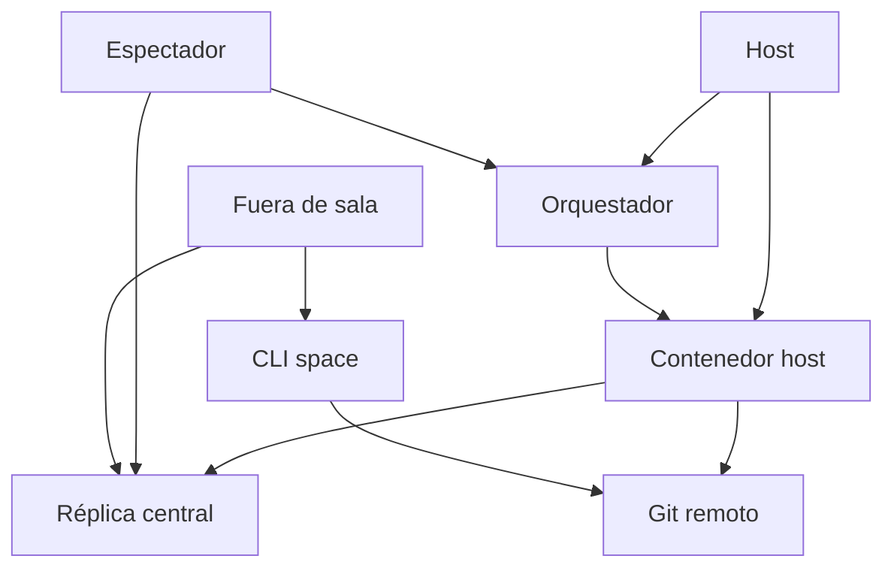
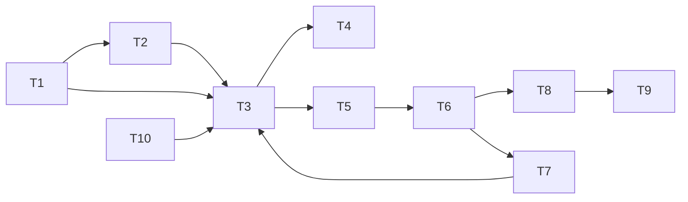
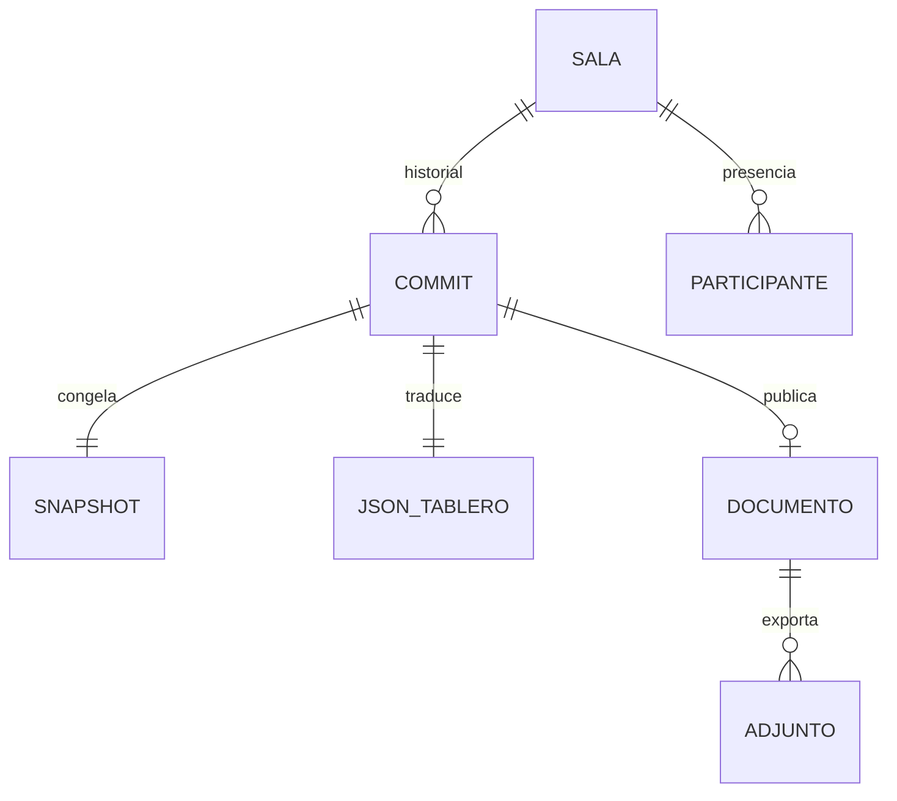
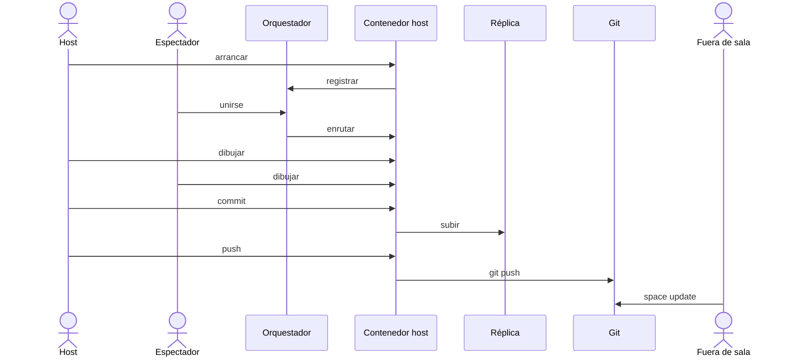
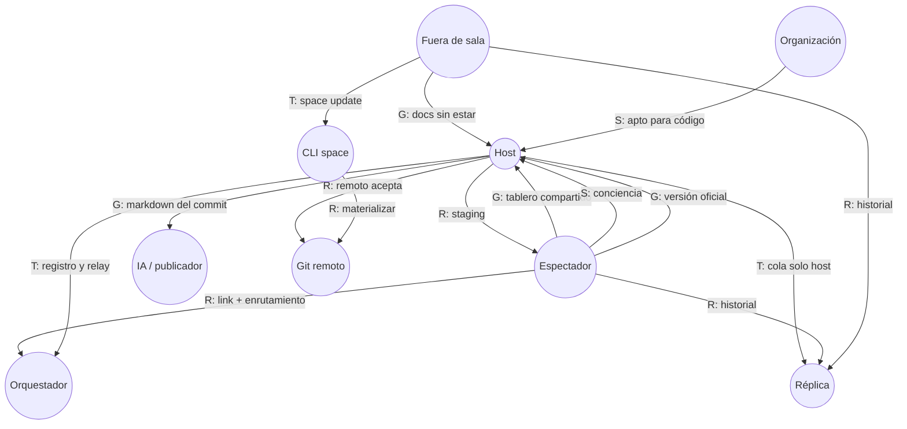

# Modelado cooperativo — HaruKoia / IOKOIA Space

Alcance esperado del sistema (pizarra, roles, CLI, IA extractora, publicación, horizonte Space). Dos modelados **separados**: primero **AMENITIES** (cuatro vistas), después **i\*** (modelo SD).

---

# Parte 1 — AMENITIES

**AMENITIES** (*A Methodology for aNalysis and DesIgn of CooperaTIve systEmS*; Garrido Bullejos, 2003). Modelado del trabajo cooperativo en cuatro vistas.

**Sistema.** Comunidad de desarrolladores que colaboran en salas de pizarra, oficializan versiones, generan documentación y la entregan a quien no estuvo en la sesión.

---

## Vista organizacional

Estructura del grupo, roles, capacidades y reglas.

| Rol | Puede | No puede |
|-----|-------|----------|
| **Host** | Arrancar sala, invitar, dibujar, staging, **commitear**, **push** (IA/export/git), alimentar réplica | Migrar host (v1); ser host local desde el teléfono |
| **Espectador** | Unirse por link + nombre, dibujar, staging, ver presencia e historial (lectura) | Commitear, push, escribir en la réplica, tocar el repo |
| **Fuera de sala** | Leer historial (réplica), materializar con CLI / git | Sync en vivo de esa sesión |
| **Orquestador** | Registrar salas, links, relay | Guardar datos de producto |
| **Réplica central** | Aceptar escritura del host; lectura a los demás | Sustituir al host como autoridad |
| **IA extractora** | Markdown (+ exportes) en el push | Escribir mientras se dibuja |
| **CLI `space`** | `host`, `status`, `update` | — |

**Modos:** sala de usuario (host en máquina del developer) · sala global (host en servidor).

**Leyes:** un host por sala; orquestador sin datos; solo el host escribe historial; sync en vivo ≠ réplica ≠ push/git; markdown solo en el push; sala muere con el host (v1).

**Horizonte Space** (misma comunidad, aún sin detalle de vistas): diseño, tipologías, mapa, tareas, minutas, calendario, correo, agentes, git UI, autenticación, entidades.

---

## Vista de comportamiento

Tareas cooperativas y sus relaciones.

| ID | Tarea | Responsable | Resultado |
|----|-------|-------------|-----------|
| T1 | Arrancar / volverse host | Host | Sala + link |
| T2 | Unirse | Espectador | Presencia |
| T3 | Dibujar / editar | Todos en sala | Tablero convergente |
| T4 | Presencia (nombre, cursor) | Todos en sala | Conciencia de grupo |
| T5 | Marcar staging | Participantes | Candidatos a versión |
| T6 | Commitear | **Solo host** | Versión oficial |
| T7 | Historial / checkout | Host aplica; otros leen | Estado desde un commit |
| T8 | Push (IA o determinista + export + git) | **Solo host** | Docs en repo |
| T9 | Materializar (`space update` / git) | Fuera de sala | Archivos locales |
| T10 | Restaurar sala | Host | Último estado vivo |
| T11 | Sala global | Host en nube | Misma cooperación sin laptop |

---

## Vista de información

Datos y recursos compartidos.

| Recurso | Escribe | Lee |
|---------|---------|-----|
| Tablero en vivo | Todos en sala | Todos en sala |
| Staging | Participantes | Grupo en sala |
| Commit (+ snapshot / JSON) | Solo host | Grupo + fuera (réplica) |
| Markdown / PDF / Word | Host en el push | Equipo (git / CLI) |
| Presencia | Cada participante | En sala |
| Estado de push / réplica | Host / sistema | Host e invitados |
| Remoto git | Host (push) | Colaboradores |

---

## Vista de interacción

Protocolos y modos de sincronización.

| Modo | Qué | Canal |
|------|-----|-------|
| Síncrono | Tablero + presencia | Relay ↔ host (Yjs) |
| Asíncrono historial | Commits y estados | Host → réplica → lectores |
| Asíncrono archivos | Entrega al equipo | Git push + `space update` |

La réplica **no** pasa por el relay.

---

# Parte 2 — i\* · modelo SD (Strategic Dependency)

Marco **i\*** (Eric Yu). **No** es AMENITIES: aquí solo el modelo **SD** — quién depende de quién (actores como caja negra).

| | |
|-|-|
| **Depender** | Quien necesita algo |
| **Dependee** | Quien se espera que lo aporte |
| **Dependum** | Lo necesario: **G** goal · **S** softgoal · **T** task · **R** resource |

| Depender | Tipo | Dependum | Dependee |
|----------|------|----------|----------|
| Espectador | G | Tablero compartido en junta | Host |
| Espectador | R | Link + enrutamiento | Orquestador |
| Host | T | Registro y relay | Orquestador |
| Espectador | S | Conciencia (presencia, estados) | Host |
| Participantes | G | Versión oficial (commit) | Host |
| Host | R | Staging del grupo | Espectadores |
| Espectador / fuera | R | Historial y estado de push | Réplica |
| Host | T | Aceptar cola solo del host | Réplica |
| Host | G | Markdown (+ exportes) del commit | IA / publicador |
| Host | R | Remoto acepta generados | Git |
| Fuera de sala | G | Docs sin haber estado | Host (+ git / CLI) |
| Fuera de sala | T | `space update` | CLI |
| Organización | S | Comunicación apta para código y repos | Host + IA + CLI |

Arco: **depender → dependee**, etiqueta `Tipo: dependum`.
)